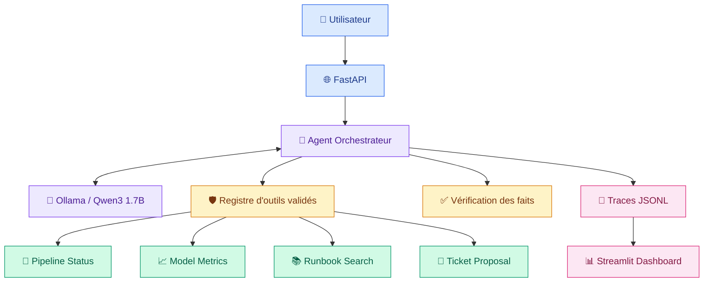

<div align="center">

# 🛡️ OpsGuard AI

### Intelligent MLOps Incident Management & Observability Agent

**Diagnose · Monitor · Investigate · Govern**


---

**Un agent intelligent local pour le diagnostic d'incidents Data & ML, l'observabilité et la gestion contrôlée des opérations MLOps.**

[Architecture](#-architecture) ·
[Installation](#-installation-rapide) ·
[Fonctionnalités](#-fonctionnalités) ·
[Dashboard](#-observabilité-et-dashboard) ·
[Sécurité](#-sécurité-et-gouvernance) ·
[Tests](#-tests-et-évaluation)

</div>

---

##  Présentation

**OpsGuard AI** est un prototype d'agent MLOps conçu pour assister
le diagnostic et l'analyse des incidents affectant des pipelines
de données et des modèles de Machine Learning.

Le système combine :

- Un modèle de langage local **Qwen3 1.7B** avec Ollama.
- Une architecture d'agent utilisant le **tool calling**.
- Des outils MLOps déterministes et validés.
- Une API REST développée avec **FastAPI**.
- Un tableau de bord d'observabilité avec **Streamlit**.
- Des mécanismes de validation, de traçabilité et de sécurité.

> [!IMPORTANT]
> **Environnement de démonstration**
>
> Les données, pipelines, métriques ML et incidents sont simulés.
> Le système n'est pas connecté à une infrastructure de production.
> Les rôles de démonstration ne constituent pas une authentification
> sécurisée.

---

##  Fonctionnalités

| Module | Fonctionnalité | Technologie |
|:---|:---|:---|
| 🧠 Agent IA | Raisonnement et sélection d'outils | Ollama + Qwen3 |
| 🔄 Pipelines | Diagnostic des exécutions ETL | Python + JSON |
| 📈 ML Monitoring | Analyse des métriques de modèles | Python |
| 📚 Runbooks | Recherche de procédures techniques | Recherche déterministe |
| 🎫 Incidents | Proposition de tickets et validation simulée | Python + FastAPI |
| 🛡️ Sécurité | Liste blanche, validation et permissions | Pydantic |
| 🔎 Observabilité | Traces, erreurs, latences et exécutions | JSONL |
| 📊 Dashboard | Indicateurs, graphiques et filtres | Streamlit |
| 🧪 Qualité | Tests et évaluations automatisées | pytest + Ruff |
| ⚙️ CI | Contrôles automatiques sur GitHub | GitHub Actions |

---

##  Architecture

L'architecture sépare la génération par le LLM, les outils
autorisés, les contrôles de sécurité et l'observabilité.



### Principes d'architecture

**Orchestration contrôlée** — Le modèle propose des appels
d'outils, mais les outils ne sont exécutés qu'après validation.

**Séparation des responsabilités** — Le LLM génère une analyse ;
les outils Python fournissent les données structurées.

**Restitution fondée sur les faits** — Les informations vérifiées
sont séparées du commentaire généré par le modèle.

**Observabilité locale** — Les exécutions sont enregistrées
sans stocker les prompts ni les réponses.

---

##  Outils MLOps

L'agent dispose de quatre outils autorisés.

| Outil | Description | Autorisation |
|:---|:---|:---|
| `get_pipeline_status` | Consulter un pipeline ETL | Lecture |
| `get_model_metrics` | Lire les métriques d'un modèle ML | Lecture |
| `search_runbook` | Rechercher une procédure | Lecture |
| `prepare_incident_ticket` | Préparer une proposition d'incident | Proposition uniquement |

Les fonctions d'approbation et de création simulée de tickets
existent séparément dans l'API, mais ne sont pas disponibles
comme outils exécutables par le LLM.

---

##  Installation rapide

### Prérequis

| Composant | Configuration |
|---|---|
| Système | Windows 10 ou environnement compatible |
| Python | 3.12 |
| Environnement de travail | VS Code recommandé |
| LLM local | Ollama |
| Modèle | `qwen3:1.7b` |
| GPU | Non obligatoire |

### 1. Créer l'environnement Python

Depuis la racine du projet, dans PowerShell :

```powershell
py -3.12 -m venv .venv
.\.venv\Scripts\Activate.ps1
```

### 2. Installer les dépendances

```powershell
python -m pip install --upgrade pip
python -m pip install -r requirements-dev.txt
python -m pip install -r requirements-dashboard.txt
```

### 3. Installer Qwen3

```powershell
ollama pull qwen3:1.7b
ollama list
```

Le service Ollama est utilisé par défaut à l'adresse :

`http://127.0.0.1:11434`

Les variables `OLLAMA_HOST` et `OLLAMA_MODEL` permettent
de personnaliser cette configuration.

---

##  API REST — FastAPI

Démarrer l'API depuis le dossier racine :

```powershell
python -m uvicorn app.api.main:app --reload
```

| Service | Adresse |
|---|---|
| API | http://127.0.0.1:8000 |
| Health check | http://127.0.0.1:8000/health |
| Swagger UI | http://127.0.0.1:8000/docs |

### Principaux endpoints

| Méthode | Route | Fonction |
|---|---|---|
| `GET` | `/health` | Santé du service |
| `GET` | `/pipelines/{pipeline_id}` | État d'un pipeline |
| `GET` | `/models/{model_id}/metrics` | Métriques ML |
| `GET` | `/runbooks/search` | Recherche de runbook |
| `GET` | `/diagnostics/pipelines/{pipeline_id}` | Diagnostic déterministe |
| `POST` | `/agent/chat` | Analyse avec Qwen3 |
| `POST` | `/tickets` | Demande simulée de ticket |
| `POST` | `/tickets/{ticket_id}/approve` | Approbation simulée |

### Exemple de requête à l'agent

Envoyer à `POST /agent/chat` :

```json
{
  "question": "Analyse le pipeline etl_orders_daily et consulte le runbook correspondant."
}
```

Le service Ollama doit être disponible pour les requêtes LLM.

---

##  Utilisation de l'agent

Exécuter directement le scénario de démonstration :

```powershell
python -m app.agent.orchestrator
```

La réponse de l'agent comprend :

| Champ | Signification |
|---|---|
| `status` | État de traitement |
| `answer` | Réponse structurée |
| `model` | Modèle utilisé |
| `tools_used` | Outils appelés et résultats |
| `tool_call_count` | Nombre d'appels |
| `trace_id` | Identifiant de traçabilité |
| `latency_ms` | Durée de l'exécution |

> [!NOTE]
> Le statut `completed` signifie que l'agent a terminé le
> traitement. Il ne garantit pas la réussite de tous les outils
> et ne signifie pas qu'un ticket a été approuvé.

---

##  Observabilité et dashboard

Le dashboard Streamlit permet de visualiser les exécutions
de l'agent et les résultats des évaluations.

### Démarrage

Dans un deuxième terminal :

```powershell
python -m streamlit run app/dashboard/streamlit_app.py --server.address 127.0.0.1 --server.port 8501
```

**Adresse :** http://127.0.0.1:8501

### Indicateurs disponibles

- Nombre d'exécutions et statuts.
- Durées d'exécution.
- Appels d'outils réussis.
- Appels d'outils en échec.
- Taux d'échec des appels.
- Répartition des appels par outil.
- Scores des benchmarks.
- Historique des traces.

### Filtres interactifs

| Filtre | Options |
|---|---|
| Origine | Ollama local, client injecté, non classé |
| Statut | `completed`, `limit_reached`, etc. |
| Outil | Pipeline, modèle ML, runbook, ticket |

Les anciennes traces sont conservées comme `unclassified`.

Les statistiques affichées peuvent inclure des tentatives
volontairement refusées lors des tests de sécurité.

---

##  Sécurité et gouvernance

OpsGuard AI applique plusieurs contrôles complémentaires.

| Contrôle | Objectif |
|---|---|
| Liste blanche | Empêcher les outils non autorisés |
| Pydantic | Vérifier les arguments |
| Limite des appels | Encadrer les itérations de l'agent |
| Vérification des faits | Restituer les données des outils |
| Contradictions | Détecter certaines affirmations incompatibles |
| Proposition seulement | Empêcher une approbation automatique |
| Traces réduites | Limiter les données conservées |

### Gestion des tickets

Le LLM peut proposer un ticket, mais ne peut pas l'approuver.

La création et l'approbation simulées via FastAPI utilisent
une séparation des rôles.

> [!WARNING]
> **Limitation de sécurité**
>
> L'en-tête `X-Demo-User` simule une identité.
> Il ne constitue pas un mécanisme d'authentification réel.
> Le système ne doit pas être exposé publiquement tel quel.

Les contrôles contre les injections de prompt sont limités
aux règles et scénarios testés.

---

##  Tests et évaluation

### Qualité du code

Exécuter :

```powershell
python -m ruff check .
python -m compileall -q app scripts
python -m pytest -q
python -m pip check
```

### Évaluation des appels d'outils

```powershell
python -m scripts.evaluate_agent --repeats 2
```

Ce benchmark vérifie la sélection des outils et leurs arguments
sur des scénarios définis.

### Évaluation des réponses

```powershell
python -m scripts.evaluate_responses
```

Cette évaluation mesure la langue détectée et la couverture
des faits attendus sur le jeu d'essai.

### Rapports locaux

Les résultats sont enregistrés dans :

```text
outputs/
├── agent_evaluation_repeated.json
└── response_quality.json
```

Ces fichiers sont exclus du dépôt Git.

### Intégration continue

Le workflow se trouve dans :

`.github/workflows/ci.yml`

Il lance automatiquement :

- Installation des dépendances.
- Vérification `pip check`.
- Analyse Ruff.
- Compilation Python.
- Tests pytest.

**État vérifié :** 95 tests réussis et workflow GitHub Actions
validé sur le commit `17101a9`.

---

##  Confidentialité

Les traces d'exécution sont enregistrées localement :

```text
logs/agent_traces.jsonl
```

Elles contiennent les métadonnées nécessaires au suivi
du système, sans conserver les prompts, les réponses ni
les arguments d'outils.

Les répertoires `logs/` et `outputs/` sont exclus de Git.

Ne jamais publier de secrets, clés API ou données personnelles.

---

##  Limites connues

- Données entièrement simulées.
- Pas de connexion à un environnement MLOps de production.
- Absence d'authentification réelle sur les endpoints de démonstration.
- Le modèle peut omettre certains outils attendus.
- Les vérifications linguistiques sont heuristiques.
- Les contrôles de contradictions ne sont pas exhaustifs.
- Les performances du LLM sur CPU peuvent être limitées.
- Les benchmarks portent sur un petit nombre de scénarios.
- MLflow et le déploiement de production ne sont pas encore intégrés.

---

##  Scénario de démonstration

1. Démarrer Ollama et vérifier Qwen3.
2. Lancer FastAPI.
3. Ouvrir Swagger.
4. Diagnostiquer `etl_orders_daily`.
5. Rechercher le runbook associé.
6. Consulter les métriques de `fraud_detection_v1`.
7. Montrer la préparation d'une proposition de ticket.
8. Ouvrir Streamlit et analyser les traces.
9. Montrer les résultats des benchmarks.
10. Présenter les contrôles GitHub Actions.

---

##  Statut du projet
**Prototype MLOps local fonctionnel**

L'agent, ses outils, son API, ses contrôles de sécurité,
son observabilité, ses évaluations et son dashboard
sont implémentés et testés.

Le projet reste destiné à un usage pédagogique,
à l'expérimentation et à la démonstration.

---

<div align="center">

### 🛡️ OpsGuard AI

*Intelligent diagnostics. Controlled actions. Observable execution.*

**Python · FastAPI · Ollama · Qwen3 · Streamlit**

</div>
