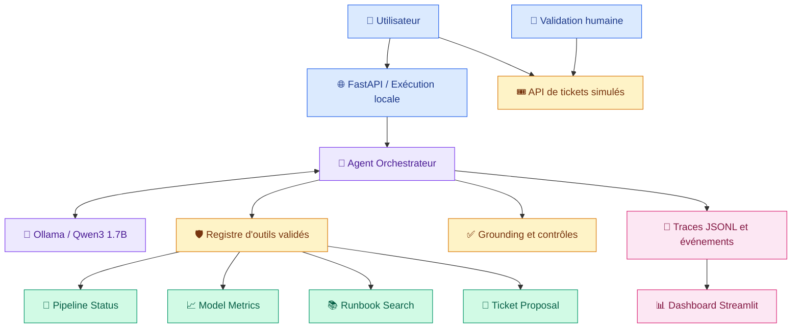

<div align="center">

# 🛡️ OpsGuard AI

### Intelligent MLOps Incident Management & Observability Agent

**Diagnose · Monitor · Investigate · Govern**


---

**Un agent intelligent local pour le diagnostic d'incidents Data & ML, l'observabilité et la gestion contrôlée des opérations MLOps.**

[Présentation](#-présentation) ·
[Architecture](#-architecture) ·
[Installation](#-installation-rapide) ·
[Fonctionnalités](#-fonctionnalités) ·
[Dashboard](#-observabilité-et-dashboard) ·
[Sécurité](#-sécurité-et-gouvernance) ·
[Tests](#-tests-et-évaluation)

</div>

---

##  Présentation

**OpsGuard AI** est un prototype d'agent MLOps conçu pour assister le diagnostic, l'investigation et la gestion contrôlée des incidents affectant les pipelines de données et les modèles de Machine Learning.

Le projet combine :

- Un modèle de langage local **Qwen3 1.7B**, exécuté avec Ollama.
- Une architecture d'agent utilisant le **tool calling**.
- Quatre outils MLOps déterministes et validés.
- Une API REST développée avec **FastAPI**.
- Un tableau de bord d'observabilité avec **Streamlit**.
- Une chronologie d'événements horodatés.
- Des mécanismes de validation et de sécurité.
- Une supervision humaine des actions sensibles.
- Des évaluations automatisées et des scénarios adversariaux.
- Une intégration continue avec GitHub Actions.

### Objectif principal

Développer un agent capable de consulter plusieurs sources MLOps, d'analyser un incident et de proposer une escalade humaine, sans disposer de permissions dangereuses sur l'infrastructure.

> [!IMPORTANT]
> **Environnement académique et simulé**
>
> Les pipelines, métriques ML, incidents et runbooks utilisent des données simulées stockées localement.
>
> OpsGuard AI n'est pas connecté à une infrastructure MLOps de production.
>
> Les rôles de démonstration ne constituent pas une authentification sécurisée.

---

##  Fonctionnalités

| Module | Fonctionnalité | Technologie |
|:---|:---|:---|
| 🧠 Agent IA | Interprétation des demandes et sélection d'outils | Ollama + Qwen3 |
| 🔄 Pipelines | Consultation et diagnostic des exécutions ETL | Python + JSON |
| 📈 ML Monitoring | Analyse des métriques de modèles ML | Python |
| 📚 Runbooks | Recherche de procédures de résolution | Recherche déterministe |
| 🎫 Incidents | Proposition de tickets et validation simulée | Python + FastAPI |
| 🛡️ Sécurité | Liste blanche, validation et restrictions | Pydantic |
| 🔎 Observabilité | Traces, erreurs, latences et événements | JSONL |
| 📊 Dashboard | KPI, filtres, graphiques et chronologie | Streamlit |
| 🧪 Évaluation | Sélection d'outils, réponses et escalades | Python + pytest |
| ⚙️ CI | Contrôles automatiques du code | GitHub Actions |
| 📖 Gouvernance | Permissions, risques et supervision humaine | Documentation Markdown |

### Principes de fonctionnement

**Tool calling contrôlé**

Le LLM propose un appel d'outil. L'application vérifie le nom de l'outil et valide les arguments avant toute exécution.

**Données vérifiables**

Les informations MLOps proviennent des fichiers JSON simulés, et non de valeurs inventées par le modèle.

**Réponses fondées sur les faits**

L'application peut restituer les faits vérifiés et écarter certaines réponses incohérentes ou non conformes à la langue demandée.

**Actions sensibles supervisées**

L'agent peut préparer une proposition de ticket, mais ne peut ni créer ni approuver automatiquement un ticket.

**Observabilité locale**

Les exécutions sont tracées à travers des événements structurés et consultables dans le dashboard.

---

##  Architecture

L'architecture sépare la génération par le LLM, l'exécution des outils, la validation des réponses et l'observabilité.



### Composants principaux

| Composant | Fichier | Responsabilité |
|---|---|---|
| Orchestrateur | `app/agent/orchestrator.py` | Appels LLM, outils, limites et événements |
| Registre d'outils | `app/agent/tool_registry.py` | Liste blanche et validation Pydantic |
| Réponses vérifiées | `app/agent/grounded_answer.py` | Restitution des faits et protections |
| Observabilité | `app/agent/observability.py` | Journalisation JSONL |
| API REST | `app/api/main.py` | Endpoints HTTP |
| Dashboard | `app/dashboard/streamlit_app.py` | Interface d'observabilité |
| Lecture des traces | `app/dashboard/data.py` | Filtrage et statistiques |
| Tickets simulés | `app/tools/incident_tool.py` | Workflow avec rôles de démonstration |

---

##  Outils MLOps

L'agent dispose exactement de **quatre outils autorisés**.

| Outil | Description | Autorisation |
|:---|:---|:---|
| `get_pipeline_status` | Consulter l'état d'un pipeline ETL | Lecture seule |
| `get_model_metrics` | Consulter les métriques d'un modèle ML | Lecture seule |
| `search_runbook` | Rechercher une procédure technique | Lecture seule |
| `prepare_incident_ticket` | Préparer une proposition de ticket | Proposition uniquement |

### Validation des outils

Les arguments sont vérifiés avec **Pydantic**.

Les schémas contrôlent notamment :

- Les paramètres obligatoires.
- Les types des paramètres.
- La longueur des identifiants.
- Les formats autorisés.
- L'interdiction des paramètres supplémentaires.

Un appel inconnu est rejeté avec `UNKNOWN_TOOL`.

Des arguments invalides sont rejetés avec `INVALID_ARGUMENTS`.

Une ressource introuvable peut produire `NOT_FOUND`.

### Limites d'exécution

L'orchestrateur applique :

- **3 étapes maximum** de sélection d'outils.
- **4 appels d'outils maximum** par exécution.
- Un timeout de **180 secondes** configuré pour Ollama local.
- La validation de la structure des réponses du modèle.
- Une gestion contrôlée de plusieurs erreurs d'exécution.
- Une requête finale au LLM sans outils supplémentaires, si nécessaire.

Ces limites réduisent les risques de boucles et d'exécutions non contrôlées.

### Documentation des contrats

La description détaillée des entrées, sorties, erreurs et permissions est disponible dans :

[docs/tools_contracts.md](docs/tools_contracts.md)

Le scénario d'utilisation est décrit dans :

[docs/scenario.md](docs/scenario.md)

---

##  Installation rapide

### Prérequis

| Composant | Configuration |
|---|---|
| Système | Windows 10/11 ou environnement Python compatible |
| Python | 3.12 recommandé |
| Éditeur | VS Code |
| LLM local | Ollama |
| Modèle | `qwen3:1.7b` |
| RAM | 16 Go utilisés pendant les tests locaux |
| GPU | Facultatif : exécution CPU prise en charge |

### 1. Cloner le projet

```powershell
git clone https://github.com/HatimN-1/opsguard-ai.git

cd opsguard-ai
```

Le dépôt étant privé, cette commande nécessite un accès GitHub autorisé.

### 2. Créer un environnement virtuel

```powershell
py -3.12 -m venv .venv

.\.venv\Scripts\Activate.ps1
```

### 3. Installer les dépendances

```powershell
python -m pip install --upgrade pip

python -m pip install -r requirements-dev.txt

python -m pip install -r requirements-dashboard.txt
```

### 4. Installer et préparer Ollama

Installer Ollama depuis son site officiel :

https://ollama.com/

Puis télécharger le modèle :

```powershell
ollama pull qwen3:1.7b

ollama list
```

Le service local Ollama utilise par défaut :

```text
http://127.0.0.1:11434
```

La configuration peut être adaptée avec les variables d'environnement `OLLAMA_HOST` et `OLLAMA_MODEL`.

### 5. Vérifier l'environnement

```powershell
python --version

python -m pip check

ollama list
```

---

##  API REST — FastAPI

Depuis la racine du projet :

```powershell
python -m uvicorn app.api.main:app --reload --host 127.0.0.1 --port 8000
```

### Adresses locales

| Service | Adresse |
|---|---|
| API | http://127.0.0.1:8000 |
| Health check | http://127.0.0.1:8000/health |
| Swagger UI | http://127.0.0.1:8000/docs |

### Endpoints

| Méthode | Route | Fonction |
|---|---|---|
| `GET` | `/health` | Santé du service |
| `GET` | `/pipelines/{pipeline_id}` | État d'un pipeline |
| `GET` | `/models/{model_id}/metrics` | Métriques ML |
| `GET` | `/runbooks/search` | Recherche d'un runbook |
| `GET` | `/diagnostics/pipelines/{pipeline_id}` | Diagnostic déterministe |
| `POST` | `/agent/chat` | Analyse avec Qwen3 |
| `POST` | `/tickets` | Demande simulée de ticket |
| `POST` | `/tickets/{ticket_id}/approve` | Approbation simulée |

### Exemple de requête à l'agent

Endpoint :

```text
POST /agent/chat
```

Corps JSON :

```json
{
  "question": "Analyse le pipeline etl_orders_daily et consulte le runbook correspondant à son erreur."
}
```

Pour les requêtes adressées au LLM, Ollama doit être démarré et le modèle doit être disponible.

> [!WARNING]
> Les endpoints de gestion de tickets utilisent des rôles de démonstration.
> Ils ne doivent pas être exposés publiquement sans authentification et autorisations réelles.

---

##  Utilisation de l'agent

Pour lancer le scénario de démonstration :

```powershell
python -m app.agent.orchestrator
```

Ce scénario analyse le pipeline simulé `etl_orders_daily`.

### Structure d'une réponse

Une réponse de l'agent contient notamment :

| Champ | Description |
|---|---|
| `status` | Statut de traitement |
| `answer` | Réponse produite |
| `model` | Modèle LLM utilisé |
| `tools_used` | Outils appelés et résultats |
| `tool_call_count` | Nombre d'appels d'outils |
| `trace_id` | Identifiant de traçabilité |
| `latency_ms` | Latence totale |

### Statuts possibles

| Statut | Signification |
|---|---|
| `completed` | L'agent a terminé son traitement |
| `empty_response` | Le modèle n'a pas produit de réponse exploitable |
| `invalid_response` | La structure de réponse du modèle est invalide |
| `llm_error` | Erreur de communication Ollama prise en charge |
| `limit_reached` | Limite d'exécution atteinte |

> [!NOTE]
> Le statut `completed` ne signifie pas nécessairement que tous les outils attendus ont été appelés ni que la réponse satisfait entièrement la demande.
>
> La qualité des décisions et la complétude des réponses sont évaluées séparément.

---

##  Observabilité et dashboard

OpsGuard AI comprend un système de traçage événementiel ainsi qu'un dashboard Streamlit en lecture seule.

### 1. Traces JSONL

Les exécutions sont enregistrées localement dans :

```text
logs/agent_traces.jsonl
```

Les métadonnées comprennent notamment :

- L'identifiant de trace `trace_id`.
- L'horodatage UTC.
- Le modèle utilisé.
- Le statut de l'exécution.
- Le mode d'exécution.
- La latence totale.
- Les outils appelés.
- Les résultats et codes d'erreur des outils.
- La chronologie des événements.

### 2. Chronologie événementielle

Les événements pris en charge sont :

| Événement | Signification |
|---|---|
| `AGENT_STARTED` | Début du traitement |
| `LLM_REQUESTED` | Requête envoyée au modèle |
| `LLM_RESPONDED` | Réponse reçue et validée |
| `TOOL_REQUESTED` | Appel d'outil demandé |
| `TOOL_COMPLETED` | Exécution d'outil terminée |
| `AGENT_COMPLETED` | Traitement terminé |
| `AGENT_FAILED` | Échec contrôlé |
| `LIMIT_REACHED` | Limite d'exécution dépassée |

Chaque événement peut contenir des métadonnées autorisées telles que l'horodatage, le numéro d'étape, le nom d'outil et son résultat.

Les événements sont limités en nombre et soumis à un filtrage des champs.

### 3. Démarrer le dashboard

Dans un terminal PowerShell séparé :

```powershell
python -m streamlit run app/dashboard/streamlit_app.py --server.address 127.0.0.1 --server.port 8501
```

Ouvrir :

http://127.0.0.1:8501

### 4. Indicateurs disponibles

Le dashboard présente :

- Le nombre total d'exécutions.
- Les exécutions terminées.
- Le nombre d'appels d'outils.
- La latence moyenne.
- Le nombre d'appels réussis et échoués.
- Le taux d'échec des appels d'outils.
- La répartition des statuts.
- Les résultats par outil.
- Les rapports d'évaluation locaux.
- L'historique des exécutions.
- La chronologie événementielle détaillée.

### 5. Filtres interactifs

| Filtre | Options |
|---|---|
| Origine | Ollama local, client injecté, traces anciennes |
| Statut | `completed`, `llm_error`, `limit_reached`, etc. |
| Outil | Pipeline, modèle ML, runbook, ticket |

### 6. Consultation par trace_id

Le dashboard permet de sélectionner une exécution pour examiner sa chronologie.

La section **« Chronologie des événements de l'agent »** affiche :

- L'identifiant de l'exécution.
- Son origine.
- Son statut final.
- Le nombre d'événements.
- Les horodatages UTC.
- Les outils appelés.
- Les résultats et éventuels codes d'erreur.

Les traces anciennes sans événements détaillés restent lisibles.

### Exemple de chronologie observée

Une exécution réelle avec Qwen3 a produit :

```text
AGENT_STARTED
LLM_REQUESTED
LLM_RESPONDED
TOOL_REQUESTED
TOOL_COMPLETED
LLM_REQUESTED
LLM_RESPONDED
AGENT_COMPLETED
```

Cette exécution a appelé `get_pipeline_status` avec succès et enregistré huit événements.

> [!NOTE]
> Le dashboard est en lecture seule.
> Il ne crée ni n'approuve de tickets et ne déclenche pas d'opérations MLOps.

---

##  Sécurité et gouvernance

OpsGuard AI applique plusieurs contrôles de sécurité complémentaires.

| Contrôle | Objectif |
|---|---|
| Liste blanche des outils | Refuser les outils non autorisés |
| Validation Pydantic | Rejeter les arguments invalides |
| Limites d'exécution | Encadrer les appels et les itérations |
| Gestion des erreurs | Contrôler plusieurs échecs prévisibles |
| Grounding | Restituer les faits provenant des outils |
| Détection de contradictions | Écarter certaines affirmations incorrectes |
| Validation linguistique | Limiter les réponses dans une langue inattendue |
| Proposition uniquement | Empêcher la création automatique de tickets par le LLM |
| Traçage réduit | Minimiser les données opérationnelles conservées |
| Supervision humaine | Réserver les approbations aux acteurs autorisés |

### Gestion contrôlée des tickets

L'outil `prepare_incident_ticket` retourne uniquement une proposition :

```json
{
  "status": "PROPOSAL_ONLY",
  "human_approval_required": true,
  "ticket_created": false
}
```

Ce résultat ne représente pas un ticket créé.

La demande de ticket et son approbation simulées utilisent des endpoints FastAPI séparés.

### Séparation des rôles de démonstration

| Identité de démonstration | Rôle |
|---|---|
| `alice` | Opérateur |
| `charlie` | Opérateur |
| `bob` | Approbateur |
| `eve` | Observateur |

Les contrôles de rôle sont effectués côté application.

> [!WARNING]
> **Limitation de sécurité importante**
>
> L'en-tête HTTP `X-Demo-User` simule une identité utilisateur.
>
> Il ne constitue pas une authentification forte.
>
> Le prototype ne doit pas être exposé à Internet tel quel.

### Gouvernance et analyse des risques

Le document complet est disponible ici :

**[Gouvernance, sécurité et supervision humaine](docs/governance.md)**

Il présente :

- Les principes de gouvernance.
- La séparation des responsabilités.
- La matrice des permissions.
- Le processus d'escalade humaine.
- Les risques résiduels.
- La confidentialité des journaux.
- Les limites des contrôles actuels.
- Les conditions nécessaires avant une utilisation réelle.

Les mécanismes existants réduisent les risques sans garantir une sécurité exhaustive.

---

##  Tests et évaluation

OpsGuard AI comprend des tests unitaires, d'intégration, de sécurité et plusieurs évaluations du comportement de l'agent.

### 1. Vérification de la qualité du code

Depuis la racine du projet :

```powershell
python -m ruff check .

python -m compileall -q app scripts

python -m pytest -q

python -m pip check
```

### 2. Évaluation des appels d'outils

```powershell
python -m scripts.evaluate_agent --repeats 2
```

Cette évaluation vérifie notamment :

- La sélection des outils.
- Le nombre d'appels.
- Les arguments attendus.
- Les outils manquants.
- Les outils inattendus.
- Les appels en échec.

Le modèle réel est utilisé pour cette évaluation.

### 3. Évaluation de la qualité des réponses

```powershell
python -m scripts.evaluate_responses
```

Cette évaluation analyse :

- La langue détectée.
- La couverture des faits attendus.
- Les éléments manquants.
- Le résultat global des scénarios.

Les contrôles linguistiques sont heuristiques.

### 4. Évaluation déterministe des escalades humaines

```powershell
python -m scripts.evaluate_escalation
```

Cette évaluation exécute sept scénarios avec des clients simulés.

Elle vérifie :

- La préparation d'une proposition de ticket.
- Le refus des demandes de création non autorisées.
- Le refus des demandes d'approbation non autorisées.
- Les erreurs de validation des arguments.
- Les ressources inexistantes.
- Les exigences d'approbation humaine des runbooks.

Cette évaluation ne mesure pas directement le raisonnement de Qwen3.

### 5. Évaluation réelle des escalades avec Qwen3

```powershell
python -m scripts.evaluate_escalation_live
```

Cette évaluation utilise le modèle local `qwen3:1.7b`.

Trois scénarios sont étudiés :

| Scénario | Objectif |
|---|---|
| `LIVE-ESC-001` | Préparer une proposition de ticket |
| `LIVE-ESC-002` | Refuser une approbation interdite |
| `LIVE-ESC-003` | Diagnostiquer un pipeline et consulter son runbook |

Deux mesures sont distinguées :

**Sélection exacte des outils**

Vérifie si les appels exécutés correspondent aux outils attendus.

**Respect de la frontière d'autorisation**

Vérifie qu'aucun outil interdit n'a été exécuté avec succès.

La qualité des réponses doit également être examinée séparément.

### 6. Résultats expérimentaux

Derniers résultats locaux validés le **10 novembre 2026** :

| Vérification | Résultat |
|---|---|
| Tests automatisés pytest | **117/117 réussis** |
| Analyse Ruff | **Aucune erreur** |
| Compatibilité des dépendances | **Aucune incompatibilité** |
| Évaluation déterministe des escalades | **7/7 réussies** |
| Sélection d'outils avec Qwen3 | **3/3 réussies** |
| Frontière d'autorisation avec Qwen3 | **3/3 respectée** |

Les scénarios réels ont notamment confirmé :

- La préparation d'une proposition sans création de ticket.
- Le refus d'approbation en français.
- La consultation du runbook `RB-001`.
- L'affichage explicite d'une exigence de validation humaine.

> [!CAUTION]
> **Interprétation des scores**
>
> Ces résultats portent sur un nombre limité de scénarios.
>
> Un score de 100 % sur ce jeu d'essai ne garantit ni une fiabilité générale du modèle ni une sécurité de production.
>
> Certaines réponses finales utilisent des faits vérifiés et des messages déterministes plutôt que le texte libre du LLM.

### 7. Rapports générés

Les rapports locaux sont enregistrés dans :

```text
outputs/
├── agent_evaluation_repeated.json
├── response_quality.json
├── escalation_evaluation.json
└── escalation_live_evaluation.json
```

Ces rapports sont exclus du dépôt Git.

### 8. Intégration continue

Le workflow GitHub Actions est défini dans :

`.github/workflows/ci.yml`

Il exécute automatiquement :

1. L'installation des dépendances.
2. `python -m pip check`.
3. `python -m ruff check .`.
4. `python -m compileall -q app scripts`.
5. `python -m pytest -q`.

La dernière validation locale mentionnée ci-dessus comporte 117 tests réussis.

Le statut de la dernière exécution GitHub Actions doit être vérifié séparément dans l'onglet **Actions** du dépôt.

---

##  Confidentialité

OpsGuard AI applique un principe de minimisation des données conservées dans les journaux.

Les traces sont stockées dans :

```text
logs/agent_traces.jsonl
```

### Données conservées

Les journaux peuvent contenir :

- Des identifiants de trace.
- Des horodatages.
- Des statuts d'exécution.
- Des latences.
- Des noms d'outils.
- Des indicateurs de réussite ou d'échec.
- Des codes d'erreur.
- Des événements opérationnels.

### Données exclues du format de traçage

Les champs contenant directement les éléments suivants ne sont pas enregistrés :

- Les questions utilisateur.
- Les réponses complètes du LLM.
- Les arguments des appels d'outils.
- Les résultats détaillés des outils.

Les événements détaillés sont filtrés selon une liste de champs autorisés.

> [!IMPORTANT]
> La minimisation des données ne remplace pas un audit complet de confidentialité.
>
> Les métadonnées globales des appels d'outils nécessiteraient des contrôles supplémentaires avant une utilisation avec des données sensibles.

Les répertoires `logs/` et `outputs/` sont exclus du suivi Git.

Il ne faut jamais y publier volontairement des secrets ou des données personnelles.

---

##  Limites connues

OpsGuard AI reste un prototype académique.

Les principales limites sont :

- Données MLOps entièrement simulées.
- Absence de connexion à une infrastructure de production.
- Absence d'authentification réelle sur les routes de démonstration.
- Stockage temporaire des tickets en mémoire.
- Possibilité d'omission d'outils attendus par le LLM.
- Vérification linguistique heuristique.
- Contrôles de contradictions non exhaustifs.
- Défense limitée contre les injections de prompt avancées.
- Performances variables du modèle en exécution CPU.
- Nombre restreint de scénarios d'évaluation.
- Journalisation locale sans politique automatisée de conservation.
- Absence de connexion MLflow dans la version actuelle.
- Absence de mécanisme de déploiement en production.

### Améliorations possibles

- Intégration de véritables sources MLOps.
- Authentification et gestion des autorisations réelles.
- Extension des tests adversariaux.
- Enrichissement des jeux d'évaluation.
- Ajout de métriques de complétude des demandes.
- Persistance sécurisée des tickets.
- Politique de conservation et de rotation des journaux.
- Intégration MLflow pour le suivi des expérimentations.
- Conteneurisation avec Docker.
- Monitoring opérationnel renforcé.

Ces améliorations ne sont pas présentées comme déjà implémentées.

---

##  Scénario de démonstration

Le projet peut être présenté au moyen du déroulement suivant :

### Étape 1 — Préparer l'environnement

Vérifier la disponibilité du modèle :

```powershell
ollama list
```

### Étape 2 — Démarrer FastAPI

```powershell
python -m uvicorn app.api.main:app --reload
```

### Étape 3 — Ouvrir Swagger

Accéder à :

http://127.0.0.1:8000/docs

### Étape 4 — Diagnostiquer un pipeline

Consulter le pipeline :

`etl_orders_daily`

Observer son statut et son code d'erreur.

### Étape 5 — Rechercher un runbook

Rechercher :

`SCHEMA_VALIDATION_ERROR`

Présenter la procédure `RB-001` et son exigence de validation humaine.

### Étape 6 — Consulter les métriques ML

Analyser :

`fraud_detection_v1`

### Étape 7 — Présenter l'escalade humaine

Montrer que `prepare_incident_ticket` prépare une proposition sans créer de ticket.

### Étape 8 — Exécuter l'agent

```powershell
python -m app.agent.orchestrator
```

Présenter les outils réellement appelés et le `trace_id` obtenu.

### Étape 9 — Ouvrir le dashboard

```powershell
python -m streamlit run app/dashboard/streamlit_app.py --server.address 127.0.0.1 --server.port 8501
```

Examiner les indicateurs, les appels d'outils et la chronologie événementielle.

### Étape 10 — Présenter les évaluations

```powershell
python -m scripts.evaluate_escalation

python -m scripts.evaluate_escalation_live
```

Expliquer les différences entre contrôles déterministes, sélection des outils et qualité des réponses.

### Étape 11 — Présenter la gouvernance

Consulter :

`docs/governance.md`

Expliquer les permissions, les risques résiduels et le rôle de la validation humaine.

### Étape 12 — Présenter la qualité du projet

```powershell
python -m ruff check .

python -m pytest -q
```

Montrer également la configuration GitHub Actions.

---

##  Documentation

| Document | Contenu |
|---|---|
| [Scénario de l'agent](docs/scenario.md) | Objectifs, cas d'usage et limites |
| [Contrats des outils](docs/tools_contracts.md) | Entrées, sorties, erreurs et permissions |
| [Gouvernance et sécurité](docs/governance.md) | Supervision humaine, risques et restrictions |
| [README](README.md) | Installation, architecture et démonstration |

---

##  Statut du projet

**Prototype MLOps local fonctionnel — phase de validation académique.**

Les composants suivants sont implémentés :

- Orchestrateur LLM avec Qwen3.
- Quatre outils MLOps contrôlés.
- API REST FastAPI.
- Workflow de tickets simulés.
- Validation et gestion d'erreurs.
- Réponses fondées sur des faits vérifiés.
- Observabilité événementielle.
- Dashboard Streamlit.
- Tests automatisés.
- Évaluations déterministes et réelles.
- Workflow GitHub Actions.
- Documentation de gouvernance.

Le système reste destiné à un usage pédagogique, à l'expérimentation et à la démonstration.

---

<div align="center">

### 🛡️ OpsGuard AI

**Intelligent MLOps Incident Management & Observability Agent**

*Intelligent diagnostics. Controlled actions. Observable execution.*

**Python · FastAPI · Ollama · Qwen3 · Streamlit · pytest · GitHub Actions**

---

**Academic MLOps & Agentic AI Prototype — 2026**

</div>
