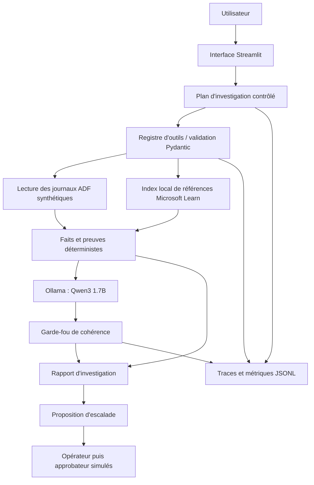

# OpsGuard AI — Agent MLOps d'investigation et de gouvernance

**Projet 3 — Agent intelligent : orchestration d'outils, observabilité et gouvernance**
**Cas d'étude : Northstar Retail (entreprise fictive)**
**Stack : Python 3.12 · Streamlit · FastAPI · Ollama / Qwen3 1.7B · pytest · GitHub Actions**

> **Périmètre académique.** Les 12 pipelines Azure Data Factory (ADF) sont fictifs et figés dans un catalogue versionné. Les exécutions et erreurs sont représentées par des journaux **synthétiques** au format ADF. La démonstration n'exécute, ne redémarre, ne modifie ni ne supprime aucun pipeline Azure réel. Les rôles humains sont simulés et ne remplacent pas une authentification de production.

## Sommaire

1. [Problème et objectifs](#1-problème-et-objectifs)
2. [Architecture](#2-architecture)
3. [Scénario métier et outils](#3-scénario-métier-et-outils)
4. [Installation reproductible](#4-installation-reproductible)
5. [Exécution et démonstration](#5-exécution-et-démonstration)
6. [Tests, évaluations et résultats](#6-tests-évaluations-et-résultats)
7. [Observabilité, sécurité et validation humaine](#7-observabilité-sécurité-et-validation-humaine)
8. [Données, versions et reproductibilité](#8-données-versions-et-reproductibilité)
9. [Limites et pistes d'amélioration](#9-limites-et-pistes-damélioration)
10. [Organisation du dépôt](#10-organisation-du-dépôt)

## 1. Problème et objectifs

Lorsqu'un pipeline ETL échoue, un opérateur doit identifier **quelle exécution** est concernée, **quelle activité** a échoué, **ce que les journaux démontrent réellement** et **quelles vérifications officielles** sont pertinentes. Un chatbot seul peut confondre plusieurs exécutions, inventer une cause racine ou proposer une action non autorisée.

**OpsGuard AI** assiste cette investigation en combinant planification, consultation d'outils contrôlés, preuves structurées et synthèse locale par Qwen3. L'objectif n'est pas d'automatiser des interventions sur Azure : l'agent **lit, explique et prépare une proposition**, tandis que l'humain décide.

Objectifs évaluables : sélection pertinente des outils, exactitude des identifiants et codes observés, gestion des erreurs et requêtes hors périmètre, latence, traçabilité, refus des actions risquées et supervision humaine.

## 2. Architecture



La partie **déterministe** collecte et vérifie les faits ; le modèle de langage intervient pour formuler une interprétation **sous contrôle**. Une réponse LLM rejetée n'annule pas l'accès aux preuves. Le catalogue des pipelines ne peut pas être modifié par les outils de l'agent.

**Composants importants :**

| Élément | Emplacement | Responsabilité |
|---|---|---|
| Catalogue métier | `data/company_adf_catalog.json` | Liste immuable de 12 pipelines ADF fictifs |
| Source des journaux | `app/adf_monitor/source.py` | Consultation bornée, normalisation et filtrage des preuves |
| Investigation | `app/adf_monitor/enterprise_agent.py` | Plan, outils, réponse Qwen3 et traçabilité |
| Registre d'outils | `app/agent/tool_registry.py` | Liste blanche, validation des arguments, gestion des erreurs |
| Garde-fou LLM | `app/adf_monitor/llm_guard.py` | Rejet de certaines affirmations non étayées |
| Documentation officielle indexée | `docs/microsoft_adf_index.json` | Recherche de recommandations associées aux codes d'erreur |
| Supervision humaine | `app/adf_monitor/business_escalation.py` | Proposition, soumission et approbation simulées |
| Interface métier | `app/dashboard/enterprise_app.py` | Tableau de bord, investigation, preuves, validation, gouvernance |
| Point d'entrée Streamlit | `app/dashboard/streamlit_app.py` | Lancement de l'interface |
| API historique / générique | `app/api/main.py` | Interface REST du prototype MLOps |

## 3. Scénario métier et outils

Le contexte **Northstar Retail** contient exactement **12 pipelines** répartis entre quatre domaines : `orders`, `customers`, `payments` et `inventory`. Les définitions et étapes métier sont fixes ; seuls les enregistrements d'exécution synthétiques évoluent dans l'espace de travail externe.

L'agent dispose de plusieurs outils enregistrés, parmi lesquels :

| Outil | Entrées principales | Sortie / erreurs possibles | Permission |
|---|---|---|---|
| `query_adf_logs` | Pipeline, Run ID, période, limite | Exécutions, activités et codes normalisés ; `NOT_FOUND`, `SOURCE_UNAVAILABLE`, arguments invalides | Lecture seule |
| `search_official_docs` | Question, code d'erreur, limite | Références Microsoft Learn indexées, ou absence de correspondance | Lecture seule |
| `get_pipeline_status` | Identifiant de pipeline simulé | Statut ou ressource introuvable | Lecture seule |
| `get_pipeline_logs` | Pipeline, Run ID | Événements et métriques simulés | Lecture seule |
| `search_runbook` | Code d'erreur | Procédure existante ou introuvable | Lecture seule |
| `get_model_metrics` | Identifiant de modèle simulé | Métriques de surveillance | Lecture seule |
| `prepare_incident_ticket` | Incident, justification | `PROPOSAL_ONLY`, **sans création automatique de ticket** | Proposition uniquement |

Les schémas Pydantic rejettent les outils inconnus, les champs non autorisés et les types invalides. Les appels sont limités en nombre ; les demandes ambiguës ou dangereuses peuvent être refusées. La consultation de Microsoft Learn passe par **un index local de références**, et non par un navigateur web autonome de l'agent.

## 4. Installation reproductible

### Prérequis

- **Windows + PowerShell** pour les commandes ci-dessous ; adaptation possible sous Linux/macOS.
- **Python 3.12** recommandé (le projet déclare Python >= 3.11).
- **Git**, connexion Internet lors de l'installation des dépendances et du téléchargement initial du modèle.
- **Ollama** installé localement pour les interprétations Qwen3. Un GPU n'est pas requis ; la performance dépend de la machine.
- Aucun abonnement Azure n'est nécessaire en mode démonstration.

### Cloner et installer

```powershell
git clone https://github.com/HatimN-1/opsguard-ai.git
cd opsguard-ai

py -3.12 -m venv .venv
.\.venv\Scripts\Activate.ps1

python -m pip install --upgrade pip
python -m pip install -r requirements-dev.txt
python -m pip install -r requirements-dashboard.txt
python -m pip check
```

Les fichiers de dépendances font foi pour la version du projet utilisée. Pour documenter un environnement exact, conserver la sortie de `python -m pip freeze` dans le dossier de reproductibilité, **sans y inclure des secrets**.

### Préparer le modèle local

Installer Ollama depuis <https://ollama.com/>, puis :

```powershell
ollama pull qwen3:1.7b
ollama list
```

Par défaut, Ollama est utilisé à `http://127.0.0.1:11434`. Le modèle attendu pour la démonstration est `qwen3:1.7b` ; relever son identifiant exact avec `ollama list` pour reproduire une campagne d'évaluation.

### Configurer la source ADF simulée

```powershell
$env:OPSGUARD_ADF_SOURCE = "external_demo"
# Facultatif : choisir un dossier EXTERNE au dépôt pour les journaux.
# $env:OPSGUARD_ADF_EXTERNAL_DIR = "C:\chemin\vers\opsguard-adf-external-workspace"
```

Le dossier par défaut est un répertoire **frère** du dépôt : `opsguard-adf-external-workspace`. Ne pas placer les journaux ADF synthétiques dans Git. Les données d'exécution sont générées localement :

```powershell
python -m scripts.simulate_company_adf --all --activities 90
```

Ce générateur ajoute des exécutions synthétiques au catalogue existant ; il ne crée pas de nouveaux pipelines Azure.

## 5. Exécution et démonstration

### Lancer le tableau de bord

```powershell
python -m streamlit run app/dashboard/streamlit_app.py --server.address 127.0.0.1 --server.port 8501
```

Ouvrir **<http://127.0.0.1:8501>**. Les cinq espaces fonctionnels sont : **Centre de contrôle**, **Agent d'investigation**, **Exécutions & preuves**, **Incidents & validation**, **Sources & gouvernance**.

### Exemple d'investigation traçable

Dans **Agent d'investigation**, sélectionner `adf_04_inventory`, une exécution synthétique en échec portant le code **3200**, puis une période qui couvre ce Run ID. Les identifiants générés varient selon le jeu local ; ne pas réutiliser aveuglément un ancien identifiant.

Question d'exemple :

> Analyse uniquement cette exécution de `adf_04_inventory`. Indique le Run ID exact, le code 3200 et l'activité en échec. Sépare les **faits confirmés dans les journaux** des **hypothèses documentées par Microsoft Learn**. Ne mélange pas plusieurs Runs et n'exécute aucune action corrective.

Résultat attendu : preuve d'une activité en échec, code et Run ID observés, vérifications suggérées à partir de l'index documentaire. **Une explication possible (ex. authentification Databricks) n'est pas une cause racine démontrée.** Le rapport reste consultable si le garde-fou rejette une formulation Qwen3.

### Démonstration de 2 minutes (format demandé dans le cahier des charges)

| Durée indicative | Manipulation | Message à transmettre |
|---|---|---|
| 0:00–0:20 | Centre de contrôle | 12 pipelines figés ; les journaux d'exécution sont synthétiques |
| 0:20–1:05 | Investigation sur un Run en échec | Plan, sélection des outils, code, activité, preuves et hypothèses |
| 1:05–1:35 | Incidents & validation | `PROPOSAL_ONLY` → `PENDING_APPROVAL` → `APPROVED`, décision humaine simulée |
| 1:35–2:00 | Sources & gouvernance / résultats | Traces, garde-fous, tests, limites du modèle |

Préparer à l'avance une exécution synthétique en échec et le dossier d'approbation de démonstration. La synthèse Ollama est locale et sa durée peut varier ; une vidéo enregistrée est plus fiable pour tenir les 2 minutes.

## 6. Tests, évaluations et résultats

### Contrôles locaux

```powershell
python -m ruff check .
python -m pytest -q
python -m pip check
python -m scripts.evaluate_enterprise_compliance --check
```

### Évaluation reproductible des outils (sans LLM)

```powershell
python -m scripts.evaluate_enterprise_llm --check
```

### Évaluation locale avec Qwen3

```powershell
python -m scripts.evaluate_enterprise_llm --live --repetitions 2 --seed 42
```

Cette dernière commande fait **12 scénarios × 2 répétitions = 24 investigations** ; elle requiert qu'Ollama et `qwen3:1.7b` soient disponibles. Les résultats sont exportés sous `outputs/` (répertoire local exclu de Git).

**Résultats de la campagne du 12 novembre 2026**, sur l'environnement de développement du projet :

| Mesure | Résultat observé | Interprétation |
|---|---:|---|
| Tests pytest | **356 réussis**, 2 ignorés | Contrôles automatisés ; une alerte de dépréciation non bloquante |
| Conformité Projet 3 hors ligne | **6/6 PASS** | Statut nominal, diagnostic, 3 outils, refus, approbation humaine |
| Vérifications retrieval / sélection / codes / documentation | **100 %** sur le protocole | Mesures déterministes sur les 12 scénarios |
| Refus des demandes non autorisées | **100 %** sur le protocole | Ne prouve pas une sécurité générale de production |
| Réponses Qwen3 acceptées par le garde-fou | **21/24 — 87,5 %** | Avant correction : 15/24 — 62,5 % |
| Réponses Qwen3 rejetées | **3/24** | 2 allégations d'échec non étayées ; 1 allégation de récurrence non étayée |
| Modèle disponible | **24/24** | Disponibilité pendant cette campagne uniquement |
| Latence moyenne par investigation LLM | **10,02 s** | Dépend du matériel, du modèle et de la charge locale |
| Fidélité sémantique globale | **Non chiffrée** | Relecture humaine nécessaire : `MANUAL_REVIEW_REQUIRED` |

La réussite du garde-fou **n'équivaut pas** à la vérité de chaque phrase. Une revue humaine ciblée a confirmé une réponse prudente sur le code 3200, mais les erreurs résiduelles doivent être présentées dans le rapport. Les pourcentages sont ceux de ce **banc d'essai synthétique**, non des performances sur des incidents Azure réels.

Les critères de conformité sont documentés par les scripts et tests ; le workflow de CI se trouve dans `.github/workflows/enterprise-adf-quality.yml`. Son succès sur GitHub doit être vérifié après publication : les résultats locaux ne prouvent pas, à eux seuls, que la CI distante a déjà réussi.

## 7. Observabilité, sécurité et validation humaine

### Traces opérationnelles

L'agent journalise des événements observables tels que `AGENT_STARTED`, `TOOL_REQUESTED`, `TOOL_COMPLETED`, `LLM_REQUESTED`, `LLM_RESPONDED` et `AGENT_COMPLETED`. Les nouvelles traces instrumentées enregistrent notamment le **motif/canal de sélection** d'un outil, son **statut** et sa **durée**, ainsi que des informations de latence et d'escalade. Les données non nécessaires au diagnostic sont filtrées ; le raisonnement interne privé du modèle n'est pas enregistré.

Les anciennes traces peuvent avoir un schéma moins riche. Elles sont **conservées sans reconstruction artificielle**. Pour vérifier une nouvelle trace, utiliser les scripts de contrôle :

```powershell
python .\scripts\verify_fresh_trace_readonly.py --mark
python -m scripts.smoke_generic_orchestrator_trace
python .\scripts\verify_fresh_trace_readonly.py --check
python .\scripts\audit_fresh_trace_quality_readonly.py
```

### Contrôle d'accès et escalade

- Les outils de lecture n'ont pas le droit de modifier l'infrastructure.
- L'agent peut proposer une escalade (`PROPOSAL_ONLY`, `human_approval_required: true`, `ticket_created: false`) mais **ne peut ni la soumettre ni l'approuver lui-même**.
- Un **opérateur simulé** soumet explicitement la demande (`PENDING_APPROVAL`) ; un **approbateur simulé distinct** peut produire la décision (`APPROVED`).
- Ces transitions sont des événements **locaux simulés**, pas un ticket de production ni un droit d'exécution Azure.
- Les validations côté application et les tests de rôles limitent les actions ; **ce n'est pas un système d'identité et d'accès de production**.

Les questions demandant un redémarrage, une suppression, une modification d'ADF ou une approbation automatique sont hors périmètre.

### Confidentialité

Ne jamais publier de fichiers `.env` contenant des valeurs réelles, de jetons, de secrets, de journaux bruts ou d'informations personnelles. Utiliser `.env.example` uniquement comme exemple public. Les dossiers `logs/`, `outputs/`, les fichiers de travail et l'espace de données ADF externe restent locaux. Les rapports d'évaluation commis à Git ne doivent contenir aucune requête privée ni identifiant sensible.

## 8. Données, versions et reproductibilité

| Élément | Référence versionnée / procédure |
|---|---|
| Code | Commit Git (`git rev-parse HEAD`) |
| Catalogue des 12 pipelines | `data/company_adf_catalog.json`, empreinte du fichier calculable par SHA-256 |
| Configurations | `config/enterprise_adf.json`, `.streamlit/config.toml` |
| Scénarios d'évaluation | `evaluation/enterprise_llm_cases.json` |
| Documentation de référence | `docs/microsoft_adf_index.json` |
| Modèle | `qwen3:1.7b` ; relever l'ID avec `ollama list` |
| Dépendances | `requirements*.txt`, environnement Python et `python -m pip freeze` |
| Journaux de simulation | Générés hors dépôt avec `scripts.simulate_company_adf` |
| Rapports expérimentaux | `outputs/` local ; conserver une copie anonymisée dans le dossier de remise |

Une répétition de campagne avec le même `--seed 42` stabilise la configuration du protocole, **mais ne garantit pas des textes LLM identiques** : les sorties du modèle et la latence peuvent varier. Le dossier de reproductibilité de remise doit préciser le matériel, la version Ollama, le commit Git, les versions des dépendances et les paramètres de la campagne.

## 9. Limites et pistes d'amélioration

1. **Simulation :** le fonctionnement a été évalué sur un catalogue fictif et des journaux ADF synthétiques, pas sur des environnements Azure de production.
2. **Fidélité LLM :** Qwen3 peut produire des formulations non étayées (échec supposé sur une exécution réussie, récurrence non prouvée). Le garde-fou en détecte certaines, mais pas toutes ; une revue humaine reste nécessaire.
3. **Échantillon limité :** 12 scénarios et 24 essais ne permettent pas de généraliser à tous les types d'incidents.
4. **Sécurité :** les utilisateurs et rôles de démonstration ne fournissent ni SSO, ni IAM, ni contrôle de production.
5. **Traçabilité historique :** certaines anciennes traces ne possèdent pas toutes les métadonnées récentes ; elles n'ont pas été modifiées a posteriori.
6. **Améliorations futures :** corpus documentaire versionné plus large, tests adversariaux supplémentaires, annotation humaine systématique des réponses, mécanismes d'authentification réels et intégration Azure en lecture seule sous contrôle strict.

## 10. Organisation du dépôt

```text
opsguard-ai/
├── app/
│   ├── adf_monitor/         # Catalogue, preuves, investigation, garde-fou, escalade
│   ├── agent/               # Orchestration générique et registre d'outils
│   ├── api/                 # API FastAPI
│   ├── dashboard/           # Interface Streamlit et CSS
│   └── simulation/          # Simulation des événements
├── config/                  # Configuration métier
├── data/                    # Catalogue versionné des 12 pipelines
├── docs/                    # Documentation technique et index Microsoft Learn
├── evaluation/              # Scénarios et labels d'évaluation
├── scripts/                 # Simulation, audits, évaluations et conformité
├── tests/                   # Tests unitaires, intégration et sécurité
├── .github/workflows/       # Quality gates CI
├── .streamlit/              # Thème Streamlit
├── requirements*.txt        # Dépendances
└── README.md
```

**Référence académique :** *Cahier des charges — Mini-projets MLOps et LLMOps*, sections 2.2, 5 et 8–10 (Projet 3, socle de qualité, monitoring et livrables). La démonstration attendue est d'environ **2 minutes** ; le rapport technique demandé est de **8 à 12 pages**.

---

**OpsGuard AI est un outil d'assistance et d'observabilité académique : les preuves structurées priment toujours sur une interprétation du modèle, et toute décision sensible reste humaine.**
