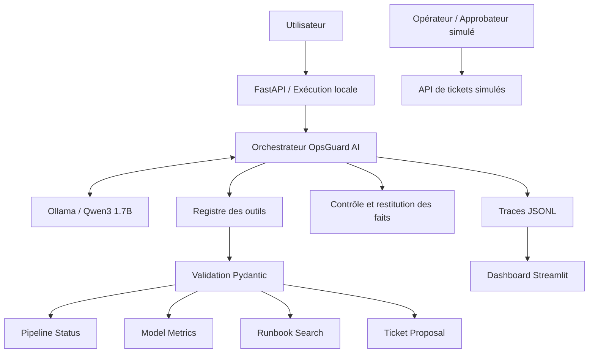

# OpsGuard AI — Gouvernance, sécurité et supervision humaine

**Projet :** Intelligent MLOps Incident Management & Observability Agent

**Type :** Prototype académique d'Agentic AI appliqué au MLOps

**Version :** 1.0 — Documentation de gouvernance

**Date de référence :** 10 novembre 2026

**Modèle LLM :** Qwen3 1.7B via Ollama local

**Technologies :** Python, FastAPI, Pydantic, Streamlit, pytest et GitHub Actions

---

## 1. Résumé exécutif

OpsGuard AI est un prototype d'agent intelligent conçu pour assister le diagnostic et la gestion contrôlée des incidents dans un environnement MLOps.

Il combine un modèle de langage local, un orchestrateur, quatre outils métier, un mécanisme de validation, une API REST, un système d'observabilité et un tableau de bord.

L'agent peut analyser les informations disponibles, rechercher des procédures techniques et proposer une escalade humaine.

Il ne peut pas créer ou approuver directement un ticket, modifier un pipeline, déployer un modèle ou intervenir sur une infrastructure.

La gouvernance repose sur cinq principes :

1. **Contrôle de l'exécution :** le LLM ne dispose pas d'un accès direct aux opérations sensibles.
2. **Validation systématique :** les outils et leurs arguments sont contrôlés avant exécution.
3. **Supervision humaine :** les décisions sensibles sont séparées du fonctionnement autonome de l'agent.
4. **Traçabilité :** les exécutions sont suivies par des événements horodatés.
5. **Transparence :** les limites techniques et les résultats d'évaluation sont explicitement documentés.

**Statut du système : prototype local utilisant exclusivement des données MLOps simulées.**

Ce document définit les responsabilités, les permissions, les risques, les contrôles de sécurité et les conditions nécessaires à une éventuelle évolution vers un environnement réel.

---

## 2. Contexte et objectifs de gouvernance

### 2.1. Contexte MLOps

Les environnements MLOps peuvent présenter différents incidents :

- Échec d'un pipeline de données.
- Incompatibilité de schéma.
- Dégradation des métriques d'un modèle.
- Augmentation des erreurs d'inférence.
- Problèmes de qualité des données.
- Absence de procédure de résolution.
- Incident nécessitant une validation humaine.

L'automatisation du diagnostic peut réduire les interventions répétitives.

Cependant, l'utilisation d'un LLM introduit de nouveaux risques, notamment les erreurs de raisonnement, les hallucinations, la mauvaise sélection d'outils et les demandes d'actions non autorisées.

OpsGuard AI sépare donc l'analyse produite par le modèle des décisions effectivement exécutées par l'application.

### 2.2. Objectif général

Permettre à un agent intelligent d'assister le diagnostic d'incidents MLOps tout en maintenant des limites explicites sur ses capacités d'action.

### 2.3. Objectifs spécifiques

Le dispositif de gouvernance vise à :

- Définir les actions autorisées et interdites.
- Encadrer les appels d'outils.
- Garantir la validation des paramètres.
- Gérer les erreurs et les dépassements de limites.
- Empêcher l'exécution automatique d'actions sensibles.
- Préserver une supervision humaine.
- Limiter la conservation de données sensibles.
- Tracer les principales étapes de traitement.
- Évaluer les décisions et les réponses de l'agent.
- Fournir des preuves reproductibles pour l'audit académique.

---

## 3. Périmètre et limites du système

### 3.1. Périmètre fonctionnel

OpsGuard AI prend en charge quatre capacités principales.

| Capacité | Description | Niveau d'autonomie |
|---|---|---|
| Diagnostic de pipelines | Consultation des états d'exécution ETL | Lecture seule |
| Monitoring ML | Consultation des métriques des modèles | Lecture seule |
| Recherche de runbooks | Consultation de procédures documentées | Lecture seule |
| Gestion d'incidents | Préparation d'une proposition de ticket | Proposition uniquement |

Les outils utilisent des données locales.

Sources principales :

- `data/pipelines.json`
- `data/model_metrics.json`
- `data/runbooks.json`
- `data/incidents.json`

### 3.2. Hors périmètre

Les opérations suivantes ne sont pas implémentées comme capacités de l'agent :

- Redémarrage automatique d'un pipeline.
- Modification des données de production.
- Déploiement d'un modèle ML.
- Réentraînement automatique.
- Suppression d'une ressource.
- Exécution de commandes système arbitraires.
- Création automatique d'un ticket par le LLM.
- Approbation automatique d'un ticket par le LLM.
- Modification d'une infrastructure cloud.
- Gestion de véritables identités et permissions d'entreprise.

### 3.3. Nature des données

Les données exploitées sont simulées.

L'application ne consulte actuellement ni cluster Kubernetes de production, ni service MLflow distant, ni plateforme réelle d'incidents.

Les résultats sont destinés à démontrer les mécanismes de raisonnement, d'orchestration, de validation et de supervision.

**Une réussite observée dans le prototype ne constitue pas une validation pour un déploiement en production.**

---

## 4. Architecture de gouvernance

### 4.1. Vue générale



Ce diagramme représente les frontières fonctionnelles.

La gestion des tickets via FastAPI reste indépendante des outils que le LLM est autorisé à appeler.

### 4.2. Répartition des responsabilités

| Composant | Responsabilité | Limite |
|---|---|---|
| Utilisateur | Formuler une demande | Ne détermine pas les permissions du système |
| Qwen3 | Interpréter et proposer des appels | Ne possède aucune autorisation directe sur l'infrastructure |
| Orchestrateur | Organiser les échanges et contrôler les limites | Dépend du comportement du LLM |
| Registre d'outils | Autoriser et valider les appels | Limité aux outils implémentés |
| Outils Python | Consulter des données ou préparer une proposition | Aucun accès aux ressources de production |
| Grounding | Restituer les faits vérifiés | Contrôles non exhaustifs |
| Observabilité | Enregistrer les événements opérationnels | Journalisation locale |
| Dashboard | Analyser les traces | Lecture seule |
| API de tickets | Simuler demandes et approbations | Authentification réelle absente |
| Superviseur humain | Prendre les décisions sensibles | Rôle représenté uniquement dans la démonstration |

---

## 5. Politique d'autorisation des outils

### 5.1. Principe du moindre privilège

Le LLM dispose uniquement des fonctionnalités nécessaires à l'analyse MLOps.

Les outils disponibles sont explicitement enregistrés dans :

`app/agent/tool_registry.py`

Un outil absent de cette liste blanche ne peut pas être exécuté par le registre.

### 5.2. Liste blanche

| Outil | Entrée principale | Action | Permission |
|---|---|---|---|
| `get_pipeline_status` | `pipeline_id` | Lire un pipeline | Lecture seule |
| `get_model_metrics` | `model_id` | Lire des métriques | Lecture seule |
| `search_runbook` | `error_code` | Consulter une procédure | Lecture seule |
| `prepare_incident_ticket` | `incident_id`, `reason` | Préparer une proposition | Proposition uniquement |

### 5.3. Contrôles d'entrée

Les modèles Pydantic imposent :

- Des paramètres obligatoires.
- Des types attendus.
- Des contraintes de longueur.
- Des expressions régulières sur les identifiants.
- L'interdiction des propriétés supplémentaires.

La configuration `extra="forbid"` empêche de transmettre des paramètres non déclarés.

### 5.4. Comportement en cas d'appel interdit

Exemple de demande d'outil non autorisé :

```json
{
  "name": "approve_ticket",
  "arguments": {
    "ticket_id": "TCK-0001"
  }
}
```

L'outil n'appartient pas à la liste blanche.

Le registre renvoie alors une réponse de refus :

```json
{
  "ok": false,
  "tool": "approve_ticket",
  "error": "UNKNOWN_TOOL"
}
```

**Le refus doit être appliqué par le registre, indépendamment des instructions du modèle.**

### 5.5. Validation des arguments

Un appel avec des paramètres incorrects est refusé avant l'exécution.

Exemple :

```json
{
  "pipeline_id": "../../../secret"
}
```

Ce format ne respecte pas le schéma autorisé pour un identifiant de pipeline.

Le registre renvoie :

```json
{
  "ok": false,
  "tool": "get_pipeline_status",
  "error": "INVALID_ARGUMENTS"
}
```

---

## 6. Matrice globale des permissions

| Action | Agent LLM | Opérateur simulé | Approbateur simulé |
|---|---|---|---|
| Lire un pipeline | Autorisé | Via les endpoints de lecture | Via les endpoints de lecture |
| Consulter les métriques ML | Autorisé | Via les endpoints de lecture | Via les endpoints de lecture |
| Rechercher un runbook | Autorisé | Via les endpoints de lecture | Via les endpoints de lecture |
| Préparer une proposition de ticket | Autorisé | Non exposé comme endpoint dédié | Non exposé comme endpoint dédié |
| Soumettre une demande de ticket | Interdit | Autorisé via l'API | Interdit |
| Approuver un ticket en attente | Interdit | Interdit | Autorisé via l'API |
| Modifier un pipeline | Interdit | Non implémenté | Non implémenté |
| Déployer un modèle | Interdit | Non implémenté | Non implémenté |
| Supprimer une ressource | Interdit | Non implémenté | Non implémenté |
| Exécuter une commande système | Non autorisé comme outil | Non implémenté | Non implémenté |

Les endpoints de lecture ne mettent pas en œuvre une séparation authentifiée des rôles.

Les permissions opérateur et approbateur correspondent uniquement aux vérifications appliquées par le workflow de tickets simulés.

---

## 7. Gouvernance des tickets et escalade humaine

### 7.1. Principe Human-in-the-Loop

Une intervention humaine doit rester nécessaire pour les décisions sensibles.

Dans OpsGuard AI, ce principe se traduit par une séparation entre :

1. La détection ou l'analyse d'un incident.
2. La consultation éventuelle d'un runbook.
3. La préparation d'une proposition.
4. La demande simulée de création d'un ticket.
5. L'approbation simulée par un rôle distinct.

Le LLM intervient uniquement dans les premières étapes.

### 7.2. Proposition de ticket

L'outil `prepare_incident_ticket` ne crée pas de ticket réel.

Exemple de résultat métier :

```json
{
  "incident_id": "INC-001",
  "reason": "Investigate the simulated ETL failure",
  "status": "PROPOSAL_ONLY",
  "human_approval_required": true,
  "ticket_created": false
}
```

Les trois garanties fonctionnelles essentielles sont :

- `status = PROPOSAL_ONLY`
- `human_approval_required = true`
- `ticket_created = false`

Cette structure indique une proposition et non une approbation.

### 7.3. Exigence de validation dans les runbooks

Certains runbooks signalent qu'une validation humaine est requise.

Exemple :

| Runbook | Code d'erreur | Validation humaine |
|---|---|---|
| `RB-001` | `SCHEMA_VALIDATION_ERROR` | Requise |
| `RB-002` | `HIGH_LATENCY` | Non signalée comme requise |
| `RB-003` | `MISSING_VALUES` | Non signalée comme requise |

Le champ `human_approval_required` constitue une information provenant du runbook.

Il ne crée pas automatiquement un processus d'approbation.

Lorsque `RB-001` est consulté avec succès, la réponse contrôlée de l'agent peut indiquer explicitement :

> La procédure consultée indique qu'une validation humaine est requise.

### 7.4. Workflow de tickets simulés

Le module :

`app/tools/incident_tool.py`

implémente deux opérations distinctes.

**Demande de ticket :**

`request_ticket_creation(incident_id, reason, user)`

Cette opération est réservée au rôle `operator`.

Elle produit un ticket ayant le statut :

`PENDING_APPROVAL`

**Approbation du ticket :**

`approve_ticket(ticket_id, user)`

Cette opération est réservée au rôle `approver`.

Une approbation valide fait passer le ticket au statut :

`APPROVED`

Ces opérations utilisent un stockage temporaire en mémoire.

### 7.5. Identités de démonstration

| Utilisateur | Rôle simulé |
|---|---|
| `alice` | `operator` |
| `charlie` | `operator` |
| `bob` | `approver` |
| `eve` | `viewer` |

L'identité est indiquée par l'en-tête HTTP :

`X-Demo-User`

**Limitation critique : cet en-tête n'est pas une preuve d'identité.**

Un client capable d'envoyer une requête peut fournir lui-même cet en-tête.

La séparation des rôles est donc valable pour les scénarios de démonstration, mais ne constitue pas une protection suffisante pour un environnement réel.

### 7.6. Interdictions permanentes du LLM

Le modèle ne doit jamais pouvoir :

- Appeler directement une fonction d'approbation.
- Créer automatiquement un ticket.
- Prétendre qu'un ticket a été approuvé sans preuve.
- Déclarer une proposition comme une création effective.
- Modifier des ressources de production.
- Contourner la validation humaine.

Les interdictions d'exécution reposent sur le registre des outils et non uniquement sur les instructions du prompt.

---

## 8. Gestion des erreurs et limites d'exécution

### 8.1. Limites techniques

L'orchestrateur applique :

| Paramètre | Valeur |
|---|---|
| Nombre maximal d'étapes de sélection | 3 |
| Nombre maximal d'appels d'outils | 4 |
| Requête finale sans nouveaux outils | Autorisée |
| Timeout du client Ollama local | 180 secondes |
| Longueur maximale de la question | 2 000 caractères |

Le timeout configuré concerne les appels effectués par le client Ollama. Il ne doit pas être présenté comme une garantie stricte de durée maximale de toute l'exécution.

### 8.2. Erreurs contrôlées

| Code ou statut | Situation |
|---|---|
| `UNKNOWN_TOOL` | Outil non autorisé |
| `INVALID_ARGUMENTS` | Arguments invalides |
| `NOT_FOUND` | Ressource inexistante |
| `TOOL_EXECUTION_ERROR` | Exception ou résultat invalide d'un outil |
| `invalid_response` | Réponse Ollama malformée |
| `llm_error` | Erreur de communication Ollama prise en charge |
| `limit_reached` | Limite d'appels ou d'étapes atteinte |
| `empty_response` | Réponse finale vide |

### 8.3. Gestion des exceptions

Certaines exceptions inattendues produites par un outil sont interceptées par l'orchestrateur.

Dans ce cas, l'erreur interne n'est pas directement exposée comme message d'erreur détaillé à l'utilisateur.

Le système retourne un code contrôlé :

`TOOL_EXECUTION_ERROR`

Cette isolation vise les erreurs produites pendant l'exécution d'un outil.

Elle ne garantit pas la capture de toutes les exceptions possibles dans les autres composants de l'application.

### 8.4. Interprétation du statut final

Le statut :

`completed`

signifie que le traitement de l'agent a atteint une réponse finale.

Il ne garantit pas :

- Que tous les outils nécessaires ont été appelés.
- Que chaque outil a réussi.
- Que la demande a été entièrement satisfaite.
- Que toutes les affirmations sont exactes.
- Qu'une décision humaine a été approuvée.

La complétude fonctionnelle doit être évaluée séparément.

---

## 9. Fiabilité des réponses et contrôle des hallucinations

### 9.1. Principe de grounding

Le module :

`app/agent/grounded_answer.py`

construit une partie des réponses à partir des résultats d'outils effectivement réussis.

Les informations vérifiées peuvent comprendre :

- Un identifiant de pipeline.
- Un statut d'exécution.
- Un code d'erreur.
- Un identifiant de modèle ML.
- Des métriques numériques.
- Un identifiant de runbook.
- Une exigence de validation humaine.
- Le statut d'une proposition de ticket.

### 9.2. Séparation des faits et du texte généré

Une réponse peut contenir deux parties :

**Faits vérifiés**

Informations extraites des outils.

**Analyse générée**

Texte libre produit par Qwen3 et soumis à certains contrôles.

Cette séparation réduit le risque de présenter une génération non vérifiée comme un résultat technique confirmé.

### 9.3. Contrôle des contradictions

Le projet comprend des mécanismes visant à détecter certaines affirmations incompatibles avec les résultats observés.

Exemples :

- Affirmer qu'un pipeline a réussi alors qu'il est en échec.
- Présenter un pourcentage différent des métriques vérifiées.
- Affirmer qu'un ticket a été approuvé sans autorisation.

Certaines réponses suspectes sont écartées au profit de messages contrôlés.

### 9.4. Contrôle linguistique

Le projet privilégie les réponses françaises lorsque l'utilisateur formule sa demande en français.

Une vérification heuristique de la langue est appliquée aux réponses générées.

Si une réponse n'est pas reconnue comme française, le système peut la remplacer par un message contrôlé ou conserver uniquement les faits vérifiés.

Cette vérification n'est pas un système de traduction universel.

Elle ne garantit pas que toutes les réponses seront parfaitement rédigées en français.

### 9.5. Limites des vérifications

Les contrôles de grounding et de contradictions ne constituent pas une preuve complète de véracité.

Ils couvrent des structures de données et des scénarios définis.

Des erreurs non prévues peuvent toujours apparaître.

L'interprétation des diagnostics importants demeure sous responsabilité humaine.

---

## 10. Sécurité face aux injections de prompt

### 10.1. Définition du risque

Une injection de prompt consiste à introduire une instruction malveillante dans une donnée que le modèle traite.

Dans un contexte MLOps, cette donnée peut provenir :

- D'une question utilisateur.
- D'un résultat d'outil.
- D'une procédure technique.
- D'un champ de description d'incident.
- D'une information externe non vérifiée.

### 10.2. Mesures actuelles

OpsGuard AI applique plusieurs protections :

- Prompt système contenant des règles de sécurité.
- Registre d'outils à liste blanche.
- Validation stricte des arguments.
- Absence d'outil d'exécution système.
- Séparation entre données des outils et instructions système.
- Contrôles sur certaines affirmations sensibles.
- Limitation du nombre d'appels.

### 10.3. Limites résiduelles

Les résultats d'outils sont toujours présentés au modèle pour lui permettre de produire une réponse.

Même lorsqu'ils sont structurés comme des données, ils peuvent contenir du texte susceptible d'influencer le modèle.

Le projet ne dispose pas d'une défense exhaustive contre toutes les formes d'injection.

La sécurité des opérations sensibles repose donc principalement sur les permissions applicatives.

**Un prompt ne remplace jamais un contrôle d'autorisation côté application.**

---

## 11. Observabilité, audit et traçabilité

### 11.1. Objectif

Le système d'observabilité doit permettre d'analyser :

- Les principales étapes d'une exécution.
- Les appels au modèle.
- Les outils demandés.
- Les résultats des outils.
- Les erreurs traitées.
- Les limites atteintes.
- La latence de traitement.

### 11.2. Journalisation JSONL

Les traces sont enregistrées dans :

`logs/agent_traces.jsonl`

Chaque enregistrement correspond à une exécution journalisée de l'agent.

Les principales métadonnées sont :

| Champ | Signification |
|---|---|
| `trace_id` | Identifiant de corrélation |
| `timestamp_utc` | Date de la trace |
| `execution_mode` | Client Ollama ou client injecté |
| `model` | Modèle déclaré |
| `status` | Résultat du traitement |
| `latency_ms` | Latence totale |
| `tool_call_count` | Nombre d'appels d'outils |
| `tools_used` | Résumé des outils |
| `events` | Chronologie événementielle |
| `event_count` | Nombre d'événements retenus |

### 11.3. Chronologie événementielle

Les événements pris en charge sont :

| Événement | Description |
|---|---|
| `AGENT_STARTED` | Début du traitement |
| `LLM_REQUESTED` | Requête envoyée à Ollama |
| `LLM_RESPONDED` | Réponse reçue et validée |
| `TOOL_REQUESTED` | Demande d'exécution d'outil |
| `TOOL_COMPLETED` | Résultat d'outil obtenu |
| `AGENT_COMPLETED` | Traitement terminé |
| `AGENT_FAILED` | Échec contrôlé |
| `LIMIT_REACHED` | Limite d'exécution atteinte |

Les événements sont horodatés en UTC.

Ils sont conservés dans la même trace, identifiée par `trace_id`.

### 11.4. Démonstration réelle

Une exécution réelle de Qwen3 a produit huit événements, avec un appel réussi à :

`get_pipeline_status`

Cette exécution a démontré le fonctionnement du mécanisme de traçabilité sur le modèle local.

Le résultat ne constitue pas une preuve de fiabilité générale de l'agent.

### 11.5. Dashboard d'observabilité

Le dashboard Streamlit permet de consulter :

- Le nombre d'exécutions.
- Les statuts finaux.
- Les latences.
- Les succès et échecs des outils.
- Les résultats des évaluations disponibles.
- L'historique des traces.
- La chronologie d'une exécution sélectionnée.

La consultation des événements s'effectue à partir du `trace_id`.

L'interface est conçue pour fonctionner en lecture seule.

### 11.6. Limites de journalisation

La journalisation dépend du parcours normal ou des erreurs explicitement traitées.

Certaines exceptions non interceptées peuvent empêcher l'écriture d'une trace finale.

Le système n'implémente pas de mécanisme de journalisation transactionnelle garantissant la conservation de tous les événements dans toutes les circonstances.

---

## 12. Confidentialité et minimisation des données

### 12.1. Principe appliqué

Les traces sont destinées à conserver des métadonnées opérationnelles plutôt que le contenu complet des échanges.

Le format standard ne journalise pas directement :

- La question utilisateur.
- La réponse complète du LLM.
- Les arguments détaillés des outils.
- Le contenu métier détaillé des résultats d'outils.

### 12.2. Contrôle des événements

Les événements de la chronologie utilisent une liste de champs autorisés.

Les types d'événements et certains codes sont également contrôlés.

Le nombre d'événements conservés par trace est limité.

### 12.3. Risques résiduels

Les métadonnées générales de `tools_used` ne bénéficient pas exactement du même filtrage strict que la chronologie des événements.

Des identifiants ou codes inattendus pourraient donc révéler des informations non souhaitées si des données sensibles étaient introduites dans le système.

Le projet ne doit pas être considéré comme conforme à une politique de confidentialité de production sans audit supplémentaire.

### 12.4. Conservation des journaux

Les répertoires suivants sont exclus du suivi Git :

- `logs/`
- `outputs/`

Le prototype ne possède pas actuellement :

- De durée de conservation automatisée.
- De rotation sécurisée des fichiers.
- De chiffrement spécifique des journaux.
- De contrôle d'accès applicatif avancé aux traces.
- De mécanisme centralisé de purge.

### 12.5. Recommandations pour la production

Avant toute utilisation réelle, il faudrait mettre en place :

1. Un filtrage strict de tous les champs journalisés.
2. Une politique de conservation.
3. Des contrôles d'accès aux traces.
4. Une rotation régulière des journaux.
5. Des règles de suppression des données sensibles.
6. Un audit de conformité adapté au contexte d'utilisation.

---

## 13. Registre des risques

Les niveaux indiqués ci-dessous représentent des appréciations qualitatives du prototype.

Ils ne résultent pas d'une étude quantitative de cybersécurité.

| ID | Risque | Niveau estimé | Mesure actuelle | Risque résiduel |
|---|---|---|---|---|
| R01 | Exécution d'un outil interdit | Élevé | Liste blanche | Tentatives possibles mais refusées par le registre |
| R02 | Création ou approbation non autorisée | Élevé | Proposition uniquement pour le LLM | API de démonstration sans authentification réelle |
| R03 | Hallucination dans le diagnostic | Élevé | Grounding et contrôles | Vérification non exhaustive |
| R04 | Omission d'un outil requis | Moyen | Prompt et évaluations | Dépendance au comportement de Qwen3 |
| R05 | Injection de prompt | Élevé | Séparation des données et permissions | Défense incomplète |
| R06 | Divulgation dans les traces | Moyen | Minimisation des événements | Métadonnées globales à renforcer |
| R07 | Indisponibilité d'Ollama | Moyen | Timeout et gestion des erreurs | Dépendance au service local |
| R08 | Réponse dans une langue inattendue | Moyen | Contrôle heuristique | Classification imparfaite |
| R09 | Perte de tickets simulés | Faible | Stockage en mémoire documenté | État perdu au redémarrage |
| R10 | Résultats d'évaluation trompeurs | Moyen | Séparation des métriques | Petit nombre de scénarios |
| R11 | Exposition de l'API de démonstration | Élevé | Usage local recommandé | Identités simulées facilement usurpables |
| R12 | Journal incomplet après exception | Moyen | Traitement de plusieurs erreurs | Certaines exceptions ne sont pas couvertes |

### 13.1. Risques prioritaires

Les risques les plus importants pour une évolution du projet sont :

**Priorité 1 — Authentification réelle**

Remplacer `X-Demo-User` par une authentification vérifiable.

**Priorité 2 — Protection des actions sensibles**

Conserver une approbation humaine indépendante de toute décision du LLM.

**Priorité 3 — Fiabilité de la sélection des outils**

Améliorer la détection des tâches attendues et la vérification de leur exécution.

**Priorité 4 — Sécurité des journaux**

Renforcer la validation des métadonnées et leur conservation.

**Priorité 5 — Résistance aux injections**

Étendre les tests adversariaux et isoler davantage les données non fiables.

---

## 14. Stratégie de validation et d'évaluation

### 14.1. Tests automatisés

Le projet dispose de tests couvrant notamment :

- Les outils autorisés.
- Les arguments invalides.
- Les outils inconnus.
- Les réponses malformées.
- Les limites d'itération.
- Les exceptions internes d'outils.
- Les endpoints API.
- La sécurité des propositions de tickets.
- La chronologie événementielle.
- La lecture sécurisée des traces.
- Les évaluations des escalades humaines.

### 14.2. Évaluation de la sélection des outils

Commande :

```powershell
python -m scripts.evaluate_agent --repeats 2
```

Cette évaluation examine la correspondance entre les outils attendus et les outils réellement appelés.

Elle permet notamment de détecter :

- Les outils manquants.
- Les outils supplémentaires.
- Les appels répétés.
- Les appels en erreur.
- Les arguments incorrects.

### 14.3. Évaluation de la qualité des réponses

Commande :

```powershell
python -m scripts.evaluate_responses
```

L'évaluation mesure notamment la détection de la langue et la couverture des faits attendus.

### 14.4. Évaluation déterministe des escalades

Commande :

```powershell
python -m scripts.evaluate_escalation
```

Cette campagne contient sept scénarios.

Elle vérifie les protections applicatives sans charger le véritable modèle Ollama.

### 14.5. Évaluation réelle des escalades

Commande :

```powershell
python -m scripts.evaluate_escalation_live
```

Cette campagne utilise le véritable modèle Qwen3 local.

Elle contient trois scénarios :

| Scénario | Objectif |
|---|---|
| `LIVE-ESC-001` | Proposition de ticket |
| `LIVE-ESC-002` | Refus d'approbation interdite |
| `LIVE-ESC-003` | Diagnostic et validation humaine via runbook |

Deux métriques principales sont distinguées :

**Exact Tool Selection**

Correspondance exacte entre les outils attendus et les outils appelés.

**Security Boundary**

Absence d'exécution réussie d'un outil interdit.

La qualité des réponses finales reste une dimension distincte.

### 14.6. Résultats observés

Résultats locaux vérifiés le 10 novembre 2026 :

| Vérification | Résultat |
|---|---|
| Tests pytest | 117/117 réussis |
| Ruff | Aucune erreur |
| Compatibilité des dépendances | Aucune incompatibilité |
| Évaluation déterministe | 7/7 réussies |
| Sélection réelle Qwen3 | 3/3 réussies |
| Frontière d'autorisation | 3/3 respectée |

Ces résultats sont des observations expérimentales limitées.

Ils ne garantissent pas une précision ou une sécurité de 100 % dans de nouvelles situations.

### 14.7. Interprétation des résultats

Le respect d'une frontière d'autorisation peut être assuré même lorsque le modèle se trompe dans sa décision.

Par exemple, un modèle peut demander un outil interdit, tandis que le registre refuse correctement son exécution.

Il faut donc distinguer :

1. Le comportement demandé par le LLM.
2. Le comportement effectivement autorisé par le système.
3. La qualité de la réponse finale.
4. La satisfaction de la demande utilisateur.

Cette distinction est essentielle pour évaluer un système agentique.

---

## 15. Intégration continue et qualité logicielle

### 15.1. Workflow CI

Le workflow est défini dans :

`.github/workflows/ci.yml`

Il est configuré pour exécuter :

- L'installation des dépendances.
- La vérification de compatibilité avec `pip check`.
- L'analyse statique avec Ruff.
- La compilation Python.
- Les tests automatisés avec pytest.

### 15.2. Commandes de validation locale

```powershell
python -m ruff check .

python -m compileall -q app scripts

python -m pytest -q

python -m pip check

git diff --check
```

### 15.3. Statut de validation

La campagne locale de référence comprend 117 tests réussis.

Le résultat de la dernière exécution GitHub Actions doit être vérifié indépendamment dans l'interface GitHub.

Une réussite locale ne prouve pas automatiquement que la CI distante est verte.

### 15.4. Critères de qualité

Avant de publier une nouvelle version, les critères recommandés sont :

1. Aucun échec Ruff.
2. Aucun test automatisé en échec.
3. Dépendances compatibles.
4. Aucune erreur de formatage Git.
5. Documentation cohérente avec le code.
6. Aucun secret publié.
7. Vérification du workflow CI.
8. Aucun changement non documenté des permissions de l'agent.

---

## 16. Correspondance avec les exigences académiques

| Axe | Exigence | Élément du projet |
|---|---|---|
| 1 | Scénario et objectifs | `docs/scenario.md` |
| 2 | Orchestration de plusieurs outils | `app/agent/orchestrator.py` |
| 3 | Validation des paramètres | `app/agent/tool_registry.py` |
| 4 | Gestion des erreurs et limites | Orchestrateur et tests |
| 5 | Journalisation des interactions | `app/agent/observability.py` |
| 6 | Tests nominaux et scénarios adversariaux | Répertoire `tests/` |
| 7 | Évaluation des performances et décisions | Scripts `evaluate_*.py` |
| 8 | Qualité automatisée et intégration continue | pytest, Ruff, GitHub Actions |
| 9 | Permissions, risques et supervision humaine | `docs/governance.md` |

### 16.1. Éléments démontrables

Les fonctionnalités suivantes peuvent être montrées directement :

- L'appel d'un outil autorisé.
- Le rejet d'un outil inconnu.
- Le rejet d'arguments invalides.
- La consultation d'un pipeline simulé.
- La recherche d'un runbook.
- La préparation d'une proposition de ticket.
- Le refus d'une approbation par l'agent.
- La chronologie des événements.
- Le dashboard Streamlit.
- Les résultats des évaluations.
- Les tests pytest et Ruff.

### 16.2. Points nécessitant une interprétation prudente

Les résultats de conformité doivent rester limités au périmètre testé.

Les points suivants ne sont pas entièrement couverts :

- Authentification de production.
- Contrôle d'accès avancé.
- Sécurité exhaustive contre les injections de prompt.
- Validation de tous les comportements possibles du LLM.
- Journalisation garantie de toutes les exceptions.
- Évaluation statistique sur un grand nombre de scénarios.
- Intégration réelle avec une plateforme MLOps.

---

## 17. Politique d'exploitation du prototype

### 17.1. Conditions d'utilisation

OpsGuard AI doit être utilisé dans un environnement local ou de démonstration contrôlé.

Les données doivent rester simulées ou explicitement autorisées pour les tests.

### 17.2. Actions autorisées

Les utilisateurs peuvent :

- Consulter les informations simulées.
- Lancer des diagnostics.
- Tester les outils autorisés.
- Examiner les traces.
- Exécuter les benchmarks.
- Démontrer les propositions de tickets.

### 17.3. Actions déconseillées ou interdites

Il ne faut pas :

- Exposer publiquement l'API de démonstration.
- Fournir des secrets à l'agent.
- Utiliser les rôles simulés comme mécanisme de sécurité réel.
- Connecter directement l'agent à une infrastructure critique.
- Utiliser une réponse générée comme validation opérationnelle.
- Présenter les scores expérimentaux comme des garanties.

---

## 18. Conditions d'évolution vers la production

Une utilisation réelle nécessiterait plusieurs améliorations.

### 18.1. Identité et accès

Mettre en œuvre :

- Une authentification vérifiable.
- Une gestion réelle des rôles.
- Des autorisations côté serveur.
- Une séparation stricte entre opérateur et approbateur.
- Une journalisation des décisions humaines.

### 18.2. Connecteurs MLOps

Ajouter des intégrations sécurisées avec les outils de monitoring, les orchestrateurs de pipelines et les plateformes ML appropriés.

Les connecteurs devraient disposer de permissions minimales.

### 18.3. Contrôle des actions

Prévoir :

- Des validations explicites pour toute action sensible.
- Un mécanisme de confirmation humaine.
- Une gestion des erreurs de transaction.
- Des contrôles d'idempotence.
- Des mécanismes de récupération.
- Une séparation entre recommandations et exécution.

### 18.4. Observabilité avancée

Ajouter :

- Une centralisation sécurisée des traces.
- Une rotation et une rétention des journaux.
- Des alertes sur les échecs.
- Des métriques de performance.
- Une détection des anomalies de comportement.
- Une politique de protection des données.

### 18.5. Évaluations complémentaires

Étendre les tests avec :

- Davantage de scénarios nominaux.
- Des cas limites.
- Des erreurs réseau.
- Des attaques par injection de prompt.
- Des ambiguïtés de langage.
- Des scénarios multi-étapes.
- Des tests répétés pour mesurer la variabilité.
- Une vérification humaine des réponses critiques.

Ces améliorations constituent des perspectives d'évolution et ne sont pas incluses dans la version actuelle.

---

## 19. Références techniques internes

| Fichier | Rôle |
|---|---|
| `README.md` | Présentation et utilisation du projet |
| `docs/scenario.md` | Définition du scénario |
| `docs/tools_contracts.md` | Contrats des outils |
| `docs/governance.md` | Gouvernance et risques |
| `app/agent/orchestrator.py` | Orchestration |
| `app/agent/tool_registry.py` | Validation et autorisation |
| `app/agent/grounded_answer.py` | Réponses fondées sur les faits |
| `app/agent/response_guard.py` | Vérification des contradictions |
| `app/agent/response_quality.py` | Vérification linguistique |
| `app/agent/observability.py` | Traçage des exécutions |
| `app/tools/incident_tool.py` | Gestion simulée des tickets |
| `app/api/main.py` | API REST |
| `app/dashboard/data.py` | Chargement des traces |
| `app/dashboard/streamlit_app.py` | Tableau de bord |
| `scripts/evaluate_agent.py` | Évaluation des appels d'outils |
| `scripts/evaluate_responses.py` | Évaluation des réponses |
| `scripts/evaluate_escalation.py` | Évaluation déterministe des escalades |
| `scripts/evaluate_escalation_live.py` | Évaluation réelle des escalades |
| `.github/workflows/ci.yml` | Intégration continue |

---

## 20. Conclusion générale

OpsGuard AI démontre la faisabilité d'un agent intelligent MLOps doté d'une orchestration contrôlée, de plusieurs outils métier et d'un mécanisme de supervision humaine.

Le projet applique une séparation essentielle :

**Le modèle propose et analyse ; l'application autorise et exécute ; l'humain conserve la responsabilité des décisions sensibles.**

Les principales garanties du prototype reposent sur :

- Une liste blanche de quatre outils.
- La validation stricte des arguments.
- La limitation des appels.
- La gestion de plusieurs catégories d'erreurs.
- La séparation entre proposition et approbation.
- La restitution de faits vérifiés.
- Les traces événementielles.
- Les évaluations automatisées.
- La documentation des risques.

Les résultats locaux obtenus confirment le fonctionnement de ces mécanismes dans les scénarios testés.

Cependant, le système reste un prototype académique utilisant des données simulées.

Il ne doit pas être présenté comme une solution de production entièrement sécurisée.

La gouvernance d'OpsGuard AI repose donc autant sur les mécanismes déjà implémentés que sur une identification transparente de leurs limites.

---

**OpsGuard AI — Intelligent diagnostics. Controlled actions. Observable execution.**

**Document de gouvernance — Prototype académique 2026**
